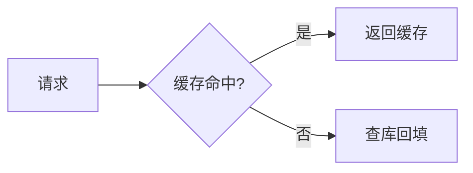

# 03 - 扩展语法与方言生态

> CommonMark 只是最小公共集，真实世界的 Markdown 是「核心 + 各自扩展」。本篇梳理 GFM 扩展、图表公式语法、六大平台方言差异与 MDX/MyST/Quarto 衍生格式，给出跨平台兼容的工程策略

---

## 目录

1. [GFM 扩展语法](#1-gfm-扩展语法)
2. [图表与数学公式](#2-图表与数学公式)
3. [主流方言对比](#3-主流方言对比)
4. [衍生格式生态](#4-衍生格式生态)
5. [跨平台兼容策略](#5-跨平台兼容策略)

---

## 1. GFM 扩展语法

GFM 在 CommonMark 之上加了五组**规范级**扩展，另有若干**实现级**能力（规范未写、GitHub 平台支持）。

### 1.1 表格

```text
| 左对齐 | 居中 | 右对齐 |
|:-------|:----:|-------:|
| a      | b    | c      |
```

规则要点：第二行分隔行决定对齐（`:---` 左、`:---:` 中、`---:` 右）；单元格内容支持行内语法；列宽不参与解析只影响源码美观。分隔行缺失或表格前无空行时，表格不会渲染——这是最高频的「表格失效」原因。

### 1.2 任务列表与删除线

`- [ ] 待办` / `- [x] 已完成` 渲染为可交互勾选框（GitHub 上点击即改源码）；`~~文本~~` 渲染删除线。任务列表注意：勾选框后必须有空格，且仅在列表项中生效。

### 1.3 Alerts 警告块（GitHub 平台级）

2023 年 12 月上线的五种提示块，语法为引用块加特殊首行：

```text
> [!NOTE]
> 一般性提示

> [!TIP]
> 技巧建议

> [!IMPORTANT]
> 关键信息

> [!WARNING]
> 警告

> [!CAUTION]
> 高风险警告
```

关键性质：**这是 GitHub 渲染器能力，不在 GFM 规范里**。降级到普通引用块后依然可读（首行会显示为 `[!NOTE]` 文本，略丑），迁移到 GitLab/VitePress 时不会报错但会失去样式。

### 1.4 脚注（实现级）

`文本[^1]` + 文末 `[^1]: 说明` 生成脚注区。GitHub 自 2021 年 9 月起全站支持，但属于 cmark-gfm 解析器扩展而非规范文本——各平台行为存在细节差异（编号样式、回跳链接）。

### 1.5 自动链接

GFM 允许裸 URL 直接成链（无需 `<>`），并识别 `www.` 前缀与部分邮箱格式。注意中文语境陷阱：**URL 结尾紧跟中文标点或汉字时会被吞进链接**，需要空格或 `<>` 隔断。

### 1.6 GitHub 平台级能力（规范之外）

除规范化的五组扩展外，GitHub 渲染器还有一批「只在 github.com 生效」的能力，写作时值得知道但**不可依赖**（本地预览、其他平台均不生效）：

- **Emoji 短代码**：`:rocket:` 渲染为表情
- **引用与关联**：`@用户名`、`#123`（Issue/PR 链接）、commit SHA 自动成链
- **富渲染语言标识**：围栏标注 `geojson`/`stl`/`mermaid` 会触发非代码渲染（GitHub 高亮引擎 Linguist 2026 年支持 700+ 语言）
- **数学公式**：`$...$` 与 `$$...$$`（MathJax 渲染）

判断准则：这些能力的共同点是「渲染依赖平台状态」（用户名是否存在、Issue 是否可见）。**在需要长期归档、跨平台分发的文档里使用它们，要有降级方案**——例如 emoji 短代码降级后是纯文本 `:rocket:`，可读性尚可；但 `#123` 在别处就是无意义的四个字符。

## 2. 图表与数学公式

### 2.1 Mermaid 图表

围栏代码块标注 `mermaid` 即渲染为图，GitHub 2022 年 2 月起支持：

````text

````

常用图类型：`flowchart`/`sequenceDiagram`/`classDiagram`/`stateDiagram-v2`/`erDiagram`/`gantt`/`mindmap`。Mermaid v10.9.0 起支持流程图中嵌入 KaTeX 数学（`$$` 包裹），默认 MathML 渲染。

### 2.2 数学公式

GitHub 2022 年 5 月起支持 LaTeX：行内 `$x^2$`、块级 `$$...$$`，基于 MathJax 渲染。自建站点通常用 KaTeX（渲染更快、体积更小，代价是 LaTeX 子集支持）。写作建议：

- 行内公式两侧留空格，避免与中文粘连
- 块级公式独立成段，前后留空行
- 反斜杠在部分环境需双写（`\\alpha`），跨平台文档先在小范围验证

> Mermaid 与数学公式都是「围栏代码块 + 特殊语言标注」的产物——这提示了一条设计原则：**扩展语法尽量复用核心语法结构**，降级后仍是合法文档。

## 3. 主流方言对比

同一份文档在不同平台渲染差异的根源，是各家扩展集不同：

| 能力 | GitHub | GitLab | Obsidian | Typora | Discord/Slack |
|------|:---:|:---:|:---:|:---:|:---:|
| GFM 五扩展 | 是 | 是 | 部分 | 是 | 部分 |
| Alerts/Callout | Alerts | 自研块语法 | `> [!note]` | 支持 | 否 |
| 双链 `[[note]]` | 否 | 否 | 是 | 否 | 否 |
| 嵌入 `![[img]]` | 否 | 否 | 是 | 否 | 否 |
| Mermaid | 是 | 是 | 是 | 是 | 否 |
| LaTeX 公式 | MathJax | KaTeX | MathJax | KaTeX | 否 |
| 脚注 | 是 | 是 | 是 | 是 | 否 |
| 严格 CommonMark | 是 | 是 | 兼容模式 | 是 | 否 |

**Obsidian 方言值得单独记**：`[[双向链接]]` 构建知识图谱，`![[文件]]` 嵌入笔记/图片，`> [!tip]` Callout 与 GitHub Alerts 语法同源但生态独立；其属性面板只支持**扁平 YAML**，嵌套 frontmatter 需插件。知识库类文档若面向 Obsidian，应避免 GFM 表格嵌套（Obsidian 表格不支持块级内容）。

差异的成因不是「谁实现得差」，而是三种设计取向：

- **平台导向**（GitHub/GitLab）：面向协作与仓库场景，扩展围绕 Issue/PR 联动与安全（tagfilter），新语法谨慎且节奏慢
- **编辑体验导向**（Obsidian/Typora）：面向个人知识管理，扩展围绕双链、嵌入、Callout，语法大胆
- **通道限制导向**（Discord/Slack）：输入框场景，只支持最小子集，表格与代码块能力受限

因此，**跨平台文档的兼容性设计要面向「最窄的通道」**——以 GFM 为写作方言，向 Discord/Slack 降级时手动转纯文本排版，而不是指望扩展语法四处通用。

## 4. 衍生格式生态

Markdown 的极简语法催生了一批「超集格式」，把文档升级为可编程内容：

- **MDX**：Markdown + JSX。文档中可直接使用 React/Vue 组件，经编译后成为组件模块，被 Docusaurus、Next.js、Astro 采用。代价是「不再是纯文本」——脱离编译链后不可读，GitHub 上只显示源码
- **MyST**：Markdown + Sphinx 生态，面向学术出版，支持引用、交叉引用、指令块，Jupyter Book 的基础
- **Quarto**：面向数据科学，一份 `.qmd` 同时产出 HTML/PDF/Word/幻灯片，内嵌代码执行结果
- **R Markdown**：Quarto 的前身，学术统计写作经典
- **AsciiDoc / Org-mode**：Markdown 的「表达力更强」替代者（AsciiDoc 特性丰富、Org 大纲编辑强），代价是学习成本与生态广度远不及 Markdown

选型建议：普通技术文档用 GFM；组件化文档站用 MDX；学术/出版用 MyST 或 Quarto；不确定时留在纯 Markdown 子集内——**纯文本是所有超集的兼容下限，也是 AI 语料的通用格式**。

选择衍生格式时问三个问题，任何一个答「是」才值得上超集：

1. **内容需要执行吗？**（代码运行结果、数据驱动的表格）→ Quarto / MyST；否则纯 Markdown 足够
2. **需要复用组件吗？**（同一份 API 参数表在 20 个页面渲染）→ MDX；单页组件需求不值得引入编译链
3. **需要严格引用体系吗？**（交叉引用、文献引用、编号自洽）→ MyST / Quarto；GitHub 上的文档不需要

三个都答「否」时坚持纯 Markdown 的收益是复合的：任何编辑器可开、任何平台可渲染、任何 AI 工具可直接消费、Git diff 干净。**升级格式容易，降级格式昂贵**——这是选择超集时的默认成本意识。

## 5. 跨平台兼容策略

跨平台（GitHub 写作 → Obsidian 阅读 → 文档站发布）的工程策略分三层：

1. **基线下限**：把 CommonMark 0.31.2 作为最小集，GFM 作为日常方言；不用平台的私有语法承载**结构性信息**（如用 Alerts 表达「唯一结论」就是结构性依赖）
2. **渐进增强**：扩展语法只做「锦上添花」——Mermaid 图降级仍可读、Alerts 降级为引用块、公式降级为 LaTeX 源码，都不破坏语义
3. **结构免依赖**：避免用 `<div>` 布局、HTML 表格代替 GFM 表格这类「渲染器敏感」写法；需要复杂排版说明目标平台已不是 Markdown 能承载的场景，应上文档站框架

> **降级测试法**：写完文档后在 GitHub 网页、VS Code 预览、纯文本编辑器三处各看一遍——三处都成立，才可发布。

---

> **核心要点**：扩展语法的选用遵循「规范内优先（GFM 五扩展）→ 平台级谨慎（Alerts/脚注）→ 私有语法隔离（双链/组件）」三层。任何扩展都要回答一个问题：**降级之后文档还成立吗？**

---

## 参考来源

- [GitHub Flavored Markdown Spec](https://github.github.com/gfm/)——五组规范级扩展正典
- [GitHub Markdown Guide（2026）](https://macmdviewer.com/blog/github-markdown-guide)——Alerts/Mermaid/LaTeX 平台侧支持时间线
- [Mermaid Math Configuration（v10.9.0+）](https://mermaid.js.org/config/math)——图中 KaTeX 数学支持
- [CommonMark vs GFM：6-Parser Diff（2026）](https://formatarc.com/en/blog/commonmark-vs-gfm/)——跨渲染器行为差异实测
- [Astro Markdown 与 MDX 文档](https://docs.astro.build/en/guides/markdown-content/)——MDX 内容集合实践

---

**上一模块**：[02-核心语法全解](02-核心语法全解.md) ｜ **下一模块**：[04-解析原理与渲染机制](04-解析原理与渲染机制.md)
